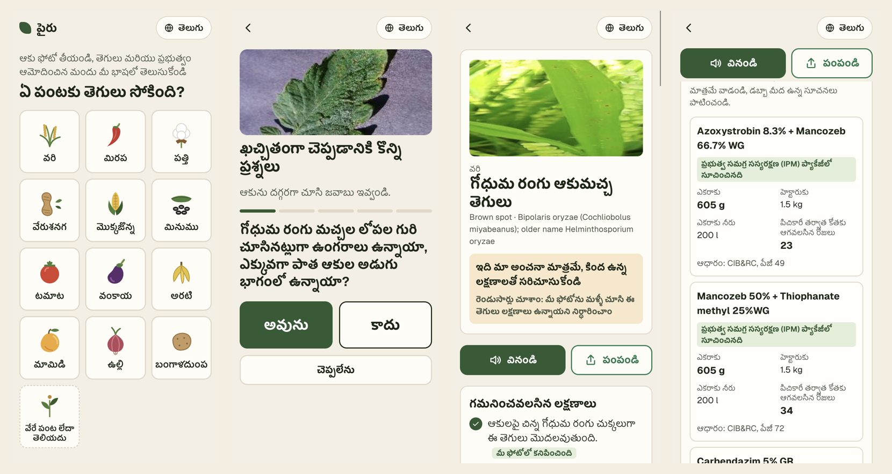

# Pairu (పైరు)

Pairu helps a farmer photograph a sick leaf and hear, in their own language, what the disease is, how sure we are, and what to do about it, using only treatments that the Government of India has approved for that crop and that pest. Pairu is Telugu for a standing crop.

**Live app:** https://pairu.tahcin.tech &nbsp;|&nbsp; **Evidence page:** https://pairu.tahcin.tech/evidence

**Demo video** (1:41, with voiceover), deck and technical documentation: https://drive.google.com/drive/folders/1WckhEcr0AZLbTv4PRPkgxdbW2QGeMv4g

Built for Avishkaar Season 4 (Virtual Track, AITAM Tekkali), problem statement AG-03: "Develop an intelligent multilingual recommendation system that provides reliable crop-specific disease-management guidance, including disease symptoms, treatment options, preventive measures, and recommended farming practices in farmers' native languages."



## What it does

1. The farmer picks a language (Telugu first, then Hindi, Tamil, Kannada, Marathi, Bengali, Odia, Gujarati, Punjabi, Malayalam and English) and taps one of 13 crop tiles.
2. They photograph the leaf, or tap or speak the symptoms they see ("describe instead"). A "Try a sample photo" sheet holds six labelled photos that are not in the test set.
3. Pairu takes a first look and, when it is not sure enough, a targeted second look at the same photo. When two diseases still look alike it asks one to three yes/no questions. When it is still unsure, or the photo is blurry or shows another crop, it says so and offers the Kisan Call Centre (1800-180-1551) or the nearest of 24 Andhra Pradesh KVKs.
4. The advice card shows the local disease name, the symptoms, a "should I spray yet?" threshold (19 pests and diseases), organic and biological options first, then the top three chemicals ranked by the government IPM package for that problem, with a checked dose per acre, water, the waiting period before harvest, the CIB&RC page, and "avoid" warnings (for example no synthetic pyrethroids for brown plant hopper). When nothing is approved for that crop and problem, it says so plainly. Then prevention, this week's tasks, a spray-weather check by location or district, listen, share and the nearest KVK.
5. "My checks" keeps past checks on the phone and reminds the farmer to recheck after 7 days. The app shell works offline as a PWA.

## How it works

**The model proposes, code decides.** No model is trained by us: a general vision model only ranks diseases from a closed list and answers yes/no questions, and every decision and every dose comes from code.

- **First look** (`functions/api/diagnose.ts`, `functions/_lib/vision.ts`): the photo (at most 1024 px) and the closed list of diseases we hold for that crop go to Gemini 3.1 Flash Lite, with a JSON schema whose id field can only be one of those ids, `<crop>_healthy` or `unknown`. Gemini 3.5 Flash Lite and then Gemma 4 are the fallbacks, and Claude Haiku 5.5 (a paid API) runs only if all of these fail, capped at 40 calls a day. The second look runs on Gemini 3.5 Flash Lite first. This is the configuration the published numbers were measured with; if the first model's daily quota runs out, Pairu falls back to 3.5 Flash Lite: 67.6% right, 18.9% wrong on the same held-out photos (n=37). Each call has a 12-second timeout.
- **Decide** (`functions/_lib/verify.ts`, `decide.ts`): at a top confidence of 0.9 or more, answer (this threshold was chosen on half of the test set only). Between 0.4 and 0.9, a **second look**: the model sees the photo again and answers yes, no or cannot tell to our knowledge-base questions that tell the candidates apart and to one "do you see this sign?" question per candidate; code keeps a disease only if its sign is seen and nothing rules it out. One survivor is shown as "checked twice" but worded as a best guess; signs the photo cannot settle become one to three questions for the farmer, where a tie stays unsure. Below 0.4, a blurry photo, another crop or nothing left means a refusal.
- **Treatments** (`functions/_lib/advice.ts`, `dose.ts`): rows from the CIB&RC register for that crop and pest; a product is dropped if any one of its actives is banned or withdrawn (streptomycin + tetracycline, proposed for a ban by a 2021 draft order, is dropped as a precaution); WHO class Ia and Ib products are flagged and placed last; the top three follow the IPM packages and skip the "avoid" list.
- **Dose check**: a printed unit is never trusted. Each formulation dose is compared with the active-ingredient column and the label percentages, and a per-acre dose is shown only when it agrees with the register's active-ingredient column; otherwise Pairu shows the register text and says read the label; only a scale that agrees within 1.5 times is converted to per acre. Per-litre rows show per litre of water, seed treatments per kg of seed, bio products as printed, and rows that do not reconcile say "check the label". Every shown per-acre dose is consistent with the register's own active-ingredient column (of the 2,088 per-acre doses shown that can be checked against the register's active-ingredient dose, 90.4% are within 10% of that calculation and 99.5% within 25%, per `node scripts/check_doses.mjs`, where all safety invariants are 0); that shows consistency with the register, not that the register has no misprints.
- **Language and voice**: Telugu for every disease name and every farmer-facing line of the knowledge base (`data/kb_te.json`), drafted by Sarvam and reviewed by an AI model against a glossary (`data/glossary_te.json`), not yet by a human agronomist. Sarvam powers translation for the other languages, speech to text (Saarika) and voice (Bulbul) when credits are available, with free fallbacks that are live: stored Gemma or Gemini translations and the phone's own text-to-speech voice. Open-Meteo gives the spray-weather check. Results and translations are cached in Workers KV, and per-IP rate limits protect the model and voice endpoints.

| Layer | Tools |
|---|---|
| Front end | React 18, Vite, TypeScript, PWA, on Cloudflare Pages |
| API | Cloudflare Pages Functions (TypeScript), Workers KV, Cache API rate limits |
| Vision | Look 1: Gemini 3.1 Flash Lite, then 3.5 Flash Lite, then Gemma 4; look 2: 3.5 first; Claude Haiku 5.5 as a paid last resort (max 40 a day) |
| Language and voice | Sarvam AI translate, speech to text, text to speech; free fallbacks (stored translations, the phone's voice) |
| Weather | Open-Meteo |
| Data pipeline | Python, pdfplumber, poppler, Node |

## Data sources

Every fact in `data/` traces to a public source; details, parsing rules and counts are in [data/SOURCES.md](data/SOURCES.md).

| File | Source | Counts |
|---|---|---|
| `registered_uses.json` | CIB&RC "Major Uses of Pesticides" lists as on 30.09.2026 | 4,454 records parsed, 2,806 for our 13 crops |
| `banned.json` | CIB&RC banned, refused and restricted list (31.10.2026), plus draft order S.O. 5295(E) of 2021 on streptomycin + tetracycline | 96 entries |
| `hazard.json` | WHO Recommended Classification of Pesticides by Hazard, 2019 | 160 actives classed |
| `kb.json`, `kb_te.json` | TNAU Agritech Portal, NIPHM and DPPQS AESA based IPM packages, DPPQS advisories, ICAR-IIHR, Vikaspedia, Crop Protection Network | 13 crops, 77 diseases and pests plus 13 healthy entries, a Telugu name for each, thresholds for 19, IPM-recommended actives for 47 |
| `kvk_ap.json` | ANGRAU, Dr. YSR Horticultural University and ICAR KVK lists | 24 KVKs for the 26 AP districts |

Crops: paddy, cotton, chilli, groundnut, maize, tomato, brinjal, banana, mango, black gram, potato, onion and cashew (added last, from the AESA cashew package and TNAU). The CIB&RC lists are, in their own words, "for guidance and not for legal purposes", so the app always tells farmers to follow the product label.

## Evaluation

A frozen, reproducible test of 95 labelled leaf photos: 77 PlantVillage lab photos and 18 field photos of rice (Sethy et al.), 80 of diseases Pairu holds and 15 of diseases it does not. Pairu is compared with the same model asked "What crop and disease is this?" with no list. The 0.9 threshold was chosen on one half of the photos (split by file-name hash), so the other half is the fair result. Full method, every row and the raw responses are in [eval/README.md](eval/README.md) and `eval/results.json`, and on the app's `/evidence` page.

| Photos of diseases Pairu holds | Pairu v2 (live) | Bare model |
|---|---|---|
| **Diseased leaves (n=65): answered and wrong** | **12 (18.5%)** | **27 (41.5%)** |
| Diseased leaves: right | 44 (67.7%) | 38 (58.5%) |
| Held-out half incl. healthy (n=37): right / answered and wrong | 28 (75.7%) / 5 (13.5%) | 19 (51.4%) / 18 (48.6%) |
| Held-out half: said not sure | 4 | 0 |
| Out of list (n=15): said not sure | 3 | 0 |

Healthy leaves are left out of the headline because the bare model's prompt asks which disease the leaf has, which pushes it to name one on a healthy leaf; the 65 diseased photos include the half used to choose the 0.9 threshold, so the held-out half is shown too.

### Lab vs field, with a PlantVillage CNN baseline

Baseline: `neghani/plantvillage-mobilenetv2` v1.0 (Apache-2.0), run locally and limited to the true crop. Field set: 44 PlantDoc photos (Singh et al. 2020, CC BY 4.0), 4 per class Pairu holds for tomato, potato and maize, frozen before any run.

| Photos | Pairu v2 right | PlantVillage CNN right |
|---|---|---|
| Lab, PlantVillage (n=65) | 46 (70.8%) | 64 (98.5%), but 52 of the 65 were in its training split |
| **Field, PlantDoc (n=44)** | **31 (70.5%), wrong 8 (18.2%), refused 5** | **17 (38.6%), wrong 23 (52.3%)** |
| Field, rice (n=15) | 12 (80.0%) | no rice classes |

A model trained on lab photos scores 98% on lab photos and 39% on field photos; Pairu holds about 70% on both. Krishi Mitra, another AG-03 entry, fine-tunes on PlantDoc and reports 67% on 236 images from the same PlantDoc test set; with n=44 our 70.5% has a 95% margin of roughly 13 points, so the two are statistically similar. Pairu's difference is what follows the diagnosis: register-checked treatments with waiting days, refusals, questions for the farmer and Telugu voice, not raw accuracy. Caveats: small n; PlantDoc labels are known to be noisy; farmer answers were scripted from the true label on 7 of the 44; the bare model was not run on PlantDoc. Details in [eval/README.md](eval/README.md).

The first look alone at 0.9 or more was right on all 23 photos that reached it. Limits we state plainly: most photos are lab photos (one leaf, plain background) and may have been seen by the model in training; there are about five photos per class, so margins are wide; the farmer's answers were scripted from the true label, which is the best case; the second look was wrong on 12 of the 37 answers it confirmed, so those are shown as a best guess; and diseases outside the list are refused only 3 times in 15.

```bash
python3 -I eval/build_testset.py fetch
eval/serve_local.sh /tmp/pairu-eval                 # local API with the Gemini key only
python3 -I eval/run.py && python3 -I eval/run_v2.py
python3 -I eval/score.py eval/runs/<v1 run>.jsonl && python3 -I eval/score_v2.py eval/runs/<v2 run>.jsonl
```

## Privacy

Photos are sent to Google's Gemini API; on the free tier Google may use inputs to improve its products, so a real pilot should use the paid tier. If both Gemini calls fail, the photo goes to Anthropic's Claude API. Pairu has no accounts and stores no photos itself; the cache keeps only the result under a hash, location is used only for the weather request, and check history stays on the phone.

## Run it locally

Needs Node 20 or later.

```bash
git clone https://github.com/tahcin/pairu.git
cd pairu
npm install
cp .dev.vars.example .dev.vars   # add GEMINI_API_KEY and SARVAM_API_KEY (ANTHROPIC_API_KEY is optional)
npm run pages:dev                # builds, then serves the app and /api with Wrangler
```

Never commit `.dev.vars`. Rebuild and check the data:

```bash
scripts/build_all.sh                                          # CIB&RC uses, banned list, WHO classes, checks
python3 -I scripts/build_kb.py && python3 -I scripts/check_kb.py
node scripts/check_doses.mjs
```

Deploy to Cloudflare Pages:

```bash
npx wrangler pages secret put GEMINI_API_KEY --project-name pairu   # and SARVAM_API_KEY, ANTHROPIC_API_KEY
npm run deploy
```

## Licence and credits

Code: MIT (see [LICENSE](LICENSE)).

Data and services: CIB&RC and DPPQS, Ministry of Agriculture and Farmers Welfare, Government of India; WHO (hazard classification, CC BY-NC-SA 3.0 IGO); Tamil Nadu Agricultural University; NIPHM; ICAR-IIHR; Vikaspedia; ANGRAU; Dr. YSR Horticultural University; Crop Protection Network; PlantVillage (Mohanty et al. 2016, CC BY-SA 3.0); Rice Leaf Disease Image Samples (Sethy et al. 2020, Mendeley Data, CC BY 4.0); Google Gemini; Sarvam AI; Open-Meteo; Cloudflare; Anthropic.

## How it was built

Pairu was built by Team Solus (Mohammad Tahcin Sarwar Barbhuiya, IIM Bangalore) during Avishkaar Season 4, inside the 24-hour build window from Nov 27, 11:30 to Nov 28, 11:30 IST, 2026, with AI coding assistance. No code or data came from earlier projects. It is a prototype: the advice comes from public government and university sources and has not yet been reviewed by a KVK scientist, so a farmer should still follow the product label and, when in doubt, call the Kisan Call Centre.
